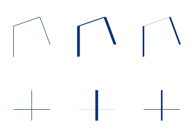
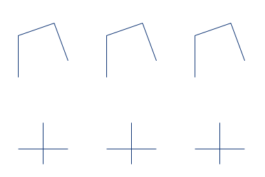
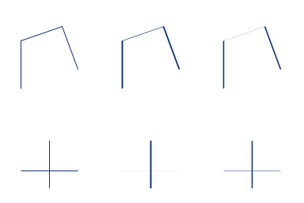
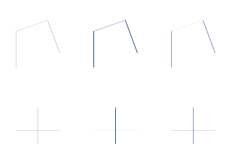
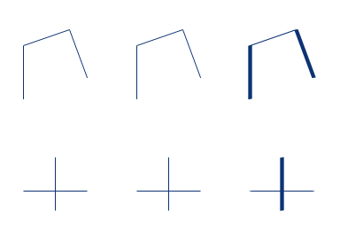

# Keep zero-width strokes device-thin under transformed coordinates

**Problem.** The same blue centerline looks thin at left but thick or uneven in the middle and right columns. A zero-width PDF stroke should not acquire a direction-dependent width when its coordinates are represented using a nonuniform scale or shear.

**Cause.** The earlier path expanded a minimum width in user space derived from the CTM's mean scale, then transformed the outline. That preserves an area scale, not a one-device-pixel thickness in every direction.

**Fix.** For explicit `0 w`, transform the centerline and construct its width, caps, and joins in device space. Dash splitting remains in user space; positive-width minimum enhancement is unchanged. The patch also addresses zero-length cap geometry, but **this visual control has no zero-length round dots**, dashes, curves, reflections, or clipping. Those broader claims need their separate tests.

**Repro and expected control.** `device-hairlines.pdf` repeats the same round-cap/round-join open polyline and two butt-cap bars at x offsets 0, 64, and 128 points. The CTMs are identity, diag(6, 0.2), and shear [1 0 3 1]. Coordinates are inverse-transformed so their page centerlines coincide after column translation. At this DPI every column is separated by exactly 128 pixels; all three should therefore have the same raster geometry, apart from implementation precision.

**Observed.** Before: column two differs from column one at 1,322 pixels and column three at 867. After: both comparisons have zero differing pixels. This independently tests the intended invariant, rather than assuming a reference is correct. The first column is the unchanged visual control; the changed pixels are confined to columns two and three. Whole-page before/after changed pixels = 2,189.

**References.** None gives perfect three-column identity: PDFium differs at 606/594 pixels, MuPDF at 527/300, PDF.js at 0/928. PDF.js's shear column remains visibly thick. Do not call all reference differences harmless AA, or claim reference agreement proves this fix. After-versus-reference whole-page MAE is 0.842/1.045/1.209 for PDFium/MuPDF/PDF.js, but thin lines occupy few page pixels. All flat-interior errors being zero is particularly uninformative here: that metric largely excludes the lines.

**Validation caveat.** The reported full Drawing suite passed 342/343 twice at the original hairline tree, with the unchanged rental-counter test failing; the isolated CanvasSnapshotDrawTests class passed 3/3 three times. Do not claim all core tests are green. No new testing or performance conclusions were added by this review.

## Raw full-page images

### Before

### After

### PDFium

### MuPDF

### PDF.js Node Canvas

The images retain native 384×256 dimensions at 144 DPI. Labels are outside the raw files. See `analytic-checks.json`, `PROVENANCE.md`, `REPRODUCTION.md`, `manifest.json`, `metrics.json` and `SHA256SUMS`.

Exact head PDF suite: 541 passed, 0 skipped. Focused geometry: 11 passed. The full-Drawing failure above remains unresolved.

Semantic basis: [ISO 32000-1:2008](https://opensource.adobe.com/dc-acrobat-sdk-docs/standards/pdfstandards/pdf/PDF32000_2008.pdf), 8.4.3.2 (zero-width strokes). Expected pixels and invariants here are derived from the original input, not copied from any specification artwork or reference.
