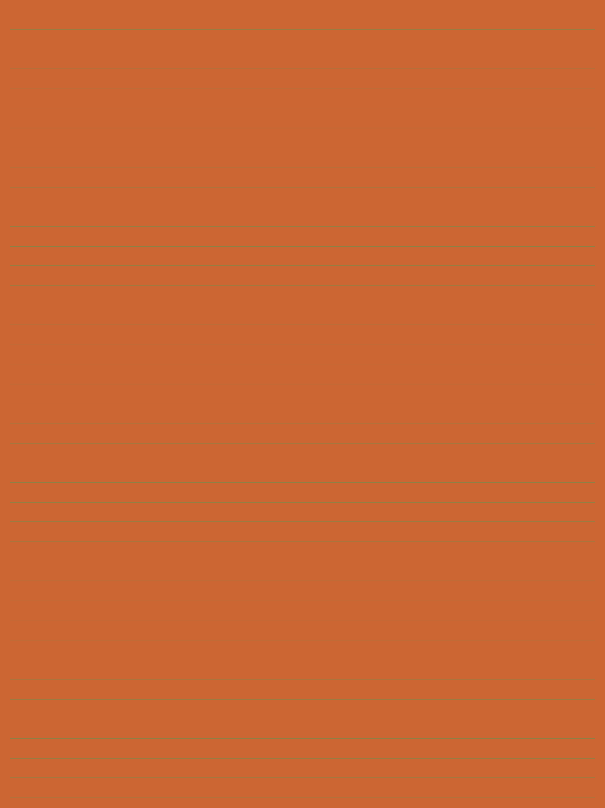

# Sample PDF canvas layers directly

Group compositing previously created an image graph for canvas content and shape coverage, then resampled/conversion-read those exact canvas pixels. CanvasLayerBrush reads locked RGBA rows directly and applies group shape coverage, while the existing Canvas.Fill path retains blending, masking and composition. Direct backdrop copying is the preceding separate fix.

This is a performance-path change, not a visible-image repair. Isolated before/after timing remains pending. The original combined950 timing cannot be allocated to each split fix.

Base `4d9bded53a962790aa72c49db9197dc716f6b93e`, tree `fb60b56c1408e1ad70a6b0432e50538196e4434b`. Head `d173137e576bc3f2cfad6aae409c3552a19e4a54`, tree `dcf44043532e7cef6c8f3d2d632cdbc802fd2b68`. Review history splits original950 without modifying original commit objects or branches. See manifest.json and the PR for mapping/checks.

## Actual generated evidence

<table><tr><th>Before</th><th>After, identical pixels</th></tr><tr><td></td><td></td></tr></table>

Both 40-group and 400-group inputs have zero differing pixels across full 833×1111 RGBA arrays, 100 DPI, degree 1. PNGs are raw full renderer output, never edited or resized. Per-render metadata includes actual assembly/input/output hashes and settings.

Use the independently authored MIT inputs, generator and harness in [the foundation bundle](../group-bounds/README.md). Build the two exact source commits separately and run the documented harness `render INPUT.pdf OUTPUT_PREFIX 100 1 false` for each PDF and source version. Keep engine directories separate. No private PDF or upstream fixture, art, fonts, text or expected image is used. All new assets here are MIT; renderer/dependency licenses remain unchanged.

Fresh PDFium, MuPDF and PDF.js custom Node references for these same inputs are in [foundation references](../group-bounds/references/provenance.json). They use native 834×1112 dimensions at 100 DPI, versus OneImage 833×1111; neither rescaling nor exact cross-engine pixel parity is claimed. PDF.js uses Node Canvas, not a native browser.

## Checks

Before PDF suite: 354 passed, 0 failed,1 known soft-mask-transfer skip. After: 365 passed, 0 failed,the same 1 skip. Focused Release builds 0 warnings/errors. OnePDF/Fonts 1.18.0 unchanged. The brush head is exactly the original950 tested source tree, not a different implementation. Native browser/Odin WebView2, AOT/WASM and full cross-platform CI remain unvalidated. The one historical soft-mask skip is resolved by the separate subsequent fix, not counted as passing here.
