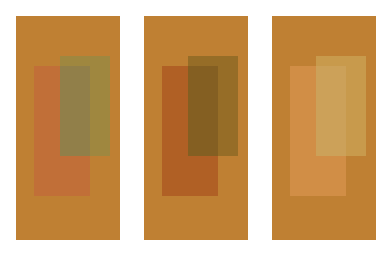
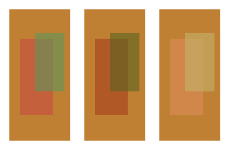
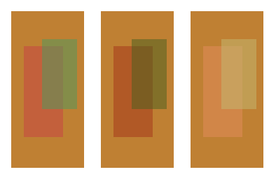
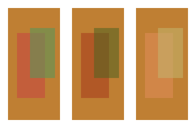

# Remove the backdrop before compositing a non-isolated group

## Problem, cause and fix

The translucent colored rectangles are too weak or incorrectly tinted because the earlier renderer composites a group result that still contains its copied backdrop, then applies the group's own coverage again. The corrected implementation removes that backdrop in premultiplied form, retains the group's own alpha separately, and applies group opacity, masks and external blending once. Normal blending uses an equivalent stable interpolation rather than division by a tiny group alpha. This is the adjacent `05-soft-mask-transfer` → `06-group-backdrop-alpha` change.

## Read the visual

Each panel contains the same original pair of overlapping red/green rectangles on ochre, each child alpha 0.55 and outer group opacity 0.65. Left to right the outer modes are Normal, Multiply and Screen. Empty backdrop space stays unchanged; single-object and overlap regions should follow distinct group-alpha values.

### Before

### After

### References

## Independent expectation

Let backdrop B=(0.75,0.5,0.2), first child R=(0.8,0.15,0.3), second child G=(0.1,0.65,0.45). Single-object group alpha is 0.55. In the overlap, group alpha is 1−0.45²=0.7975 and group-only color is (0.55G+0.55×0.45R)/0.7975. For each region the expected opaque-backdrop result is B×(1−0.65a)+Blend(B,C)×0.65a. Blend is C, B×C or 1−(1−B)(1−C), respectively. These are derived from this control's numbers, not fitted to a reference. The group/backdrop distinction follows [ISO 32000-1:2008, 11.4.8](https://opensource.adobe.com/dc-acrobat-sdk-docs/standards/pdfstandards/pdf/PDF32000_2008.pdf).

The nine interior checks in `analytic-checks.json` have maximum channel error 27.006 before and 0.889 after against those continuous expected bytes. For example the Normal green-only point (50,80) should be approximately (131.994,141.174,73.791); before is (159,135,63), after (132,142,74). All three references corroborate the behavior with small rounding differences. They are observations, not an oracle selected by closest error.

## Measurements and validation

28,740/98,304 pixels change. Whole-page RGB MAE against PDFium is 1.6045→0.1419; MuPDF 1.7843→0.3656; PDF.js Node Canvas 1.6434→0.0847. These scores are descriptive only. This PDF shows an opaque backdrop and three blend modes; it does not visually establish every translucent-backdrop, masked, nested or tiling case covered by source tests.

Exact review-head full PDF suite: 447 passed, 0 skipped. A separate deliberate production-revert control failed 19/71 GroupAlpha cases while 52 controls passed, as recorded by source review. No cross-platform/native-browser claim or performance claim is made. Input, raw PNG/RGBA and captured DLL hashes match the exact trees; generator reproduction is byte-identical. See provenance, reproduction, manifest and hashes alongside this file.
