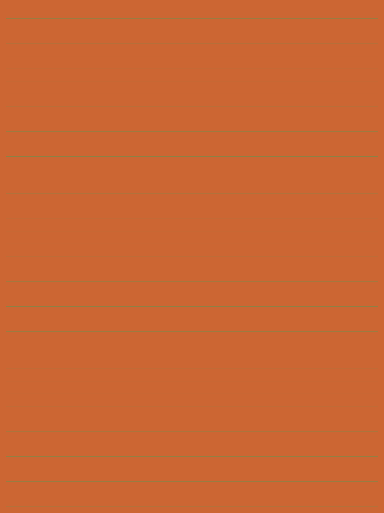

# Bound PDF transparency-group work to form coverage

## Problem, cause and fix

Narrow transparency groups were copying their backdrop and compositing their result across an entire render cell, even when their transformed form bounds cover only a thin strip. This wastes work; it is a performance defect, not an appearance correction.

Commit `c705783366878618d17e3d60f7d64c838d20f42f` computes the group's device-space coverage, rounds outward with one pixel of rasterizer slack, clamps it to the current cell, and uses that area for backdrop copy and final compositing. Non-finite bounds conservatively keep the whole-cell path. The direct-layer access and fused-blending optimizations are separate later changes, absent from this comparison.

- Before: `eb47d5a0155bdb38f6fc7b08a5fa7279fd004a12`, the fork's unchanged main.
- After: `c705783366878618d17e3d60f7d64c838d20f42f`, exactly one original commit.

## Visual evidence: unchanged pixels

These are direct full-page renderer PNGs of an original generated PDF, 833 × 1111 pixels at 100 DPI, degree 1, opaque-white renderer background, default page box, rotation 0. Labels are outside the files. There are no screenshots of private documents and no retouching or pixel resizing. Display sizing below does not alter the linked PNGs.

| Before: whole-cell group work | After: bounded group work |
|---|---|
|  |  |

Both the **40-group and 400-group** inputs produce **zero changed pixels out of 925,463 pixels**. The 40-group RGBA SHA-256 is `31b824f6a6085ccc388080f99c70dcd4e5f3c5cde04fbc49b0c6b604b31c6727` in both builds. The 400-group hash is `d445d00e3314707c8736a7e9e4844621427073712aadb6fd1397baf88f9db17e` in both builds. Full outputs, metadata and input bytes are included.

## Bounded timing evidence

Synthetic 40-group fixture only. Same Linux x64 environment, .NET SDK 10.0.404/runtime 10.0.15, Release, `DOTNET_PROCESSOR_COUNT=2`, render degree 1. Other coordinated build/render work was paused. Default tiering/PGO settings were not overridden. Each process used 20 warmups and 30 samples per boundary. Order was before-A, after-A, after-B, before-B, providing same-binary repeat controls.

| Boundary | Before A / B median | After A / B median |
|---|---|---|
| Fresh document from resident bytes, load + RGBA render | 198.700 / 198.854 ms | 23.553 / 23.309 ms |
| Retained document, release decoded output + rerasterize | 199.760 / 198.119 ms | 19.702 / 20.611 ms |

The paired medians support a time reduction of approximately **8.5× for load+render and 9.9× for retained raster on this workload**. Repeat-control median differences were 0.08% and 0.82% for the baseline boundaries, and 1.05% and 4.61% for the candidate. Every timed render had the same complete RGBA hash. Raw arrays, ranges, hashes and settings are in `measurements/`.

These are bounded synthetic measurements, not general renderer parity, cold-start measurements, peak-memory measurements, full-document coverage, or a browser/WebView presentation benchmark. File I/O, fixture generation, PNG encoding and output hashing are outside the timed interval. Individual samples have outliers; the full sample data are retained.

## Exact checks and limits

- Before Release PDF build: 0 warnings/errors. PDF tests: 343 passed, 0 failed, 1 known soft-mask transfer skip (344 total).
- After Release PDF build: 0 warnings/errors. PDF tests: 352 passed, 0 failed, the same 1 known skip (353 total).
- Added group-bounds coverage includes transformed/fractional forms, explicit-clip comparisons, cell-boundary regions and soft masks. The nine new cases run at the actual after commit.
- Both snapshots retain `RecursiveAI.OnePdf` and `RecursiveAI.OnePdf.Fonts` 1.18.0. No new parser integration or dependency change is implied.
- Fresh PDFium, MuPDF and PDF.js custom Node diagnostic reference images for these exact MIT inputs are included in references/. The images above remain the actual OneImage parent/head outputs. Reference engines use their native 834×1112 grid; OneImage uses 833×1111.
- Full solution/cross-platform CI, AOT, WASM, Odin WebView2 and Mozilla PDF.js endpoint validation are not established by these checks. Standalone native renderer timing is not substituted for either endpoint.

## Reproduce and license

See [REPRODUCTION.md](REPRODUCTION.md), [verification.json](verification.json), [fixtures.json](fixtures.json), the self-contained harness and `generate.py`. The generator is adapted from the original `PdfNarrowGroupBenchmarks.Document` builder in this exact fix. It creates all PDF bytes itself. No user documents, installed/private fonts, third-party PDF assets, or private derived pixels are read or included.

All newly authored files in this evidence directory, including the generated PDF inputs and their rendered PNGs, are explicitly provided under the [MIT license](LICENSE). See [PROVENANCE.md](PROVENANCE.md) for the asset audit. This does not change the licenses of the existing project or its dependencies. `SHA256SUMS` records all published files except itself.

## Fresh independent references

The [reference bundle](references/README.md) now contains fresh full outputs from PDFium, MuPDF and PDF.js custom Node Canvas for both original MIT inputs. Native dimensions are 834×1112 versus OneImage 833×1111 at the same 100 DPI. No resampling, cross-engine exact-pixel claim or native-browser parity is implied. Exact versions, options, commands and hashes are included.
