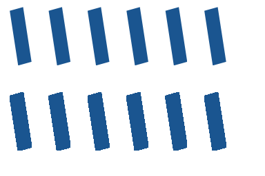
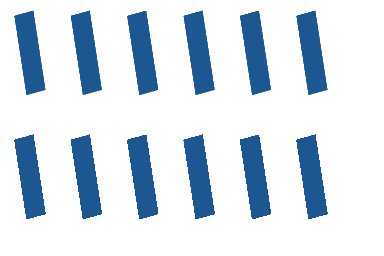

# Do not apply a redundant image-edge clip twice

**Problem.** The top row's thin slanted blue image strips have lighter shared edges than otherwise equivalent strips below. The difference is subtle at full-page size, so the explanatory caption and invariant measurement matter.

**Cause.** An image quad and a coincident polygon clip each contributed antialiased coverage. Multiplying the two coverages attenuates a shared edge twice (approximately c² instead of c), although the geometric intersection is unchanged.

**Fix.** Omit a redundant clip only when a bounded conservative test proves that one convex polygon of at most eight vertices contains the image quad. Partial, curved, complex, and uncertain clips retain the fallback. Core drawing's general independent shape/clip coverage rule is unchanged. The source also uses this decision for patterned stencils; this PDF tests only an ordinary RGB image.

**Repro and expected control.** `image-edge-clip.pdf` contains a 1×1 RGB image (28,87,146), shown six times per row under [9.7 2.7 -6.1 39.8 x y]. The top row explicitly clips to its unit square, exactly the image quad after transformation; the bottom does not. The rows differ by 62 points = 124 pixels. Intersecting a shape with itself leaves its geometric area unchanged; matching fractional placement permits a direct translated-row check. PDF does not prescribe one universal cross-renderer AA kernel, so the expected claim is geometric equivalence and OneImage consistency, not universal byte equality to any engine.

**Observed.** Comparing top rows 0…123 to bottom rows 124…247 gives 1,345 differing pixels before (maximum channel difference 57), and **zero** after. Before/after changes occur only in the top row's bounds [14,10,327,95]; the unclipped row is the unchanged control. This is stronger evidence for the intended behavior than a marginal page-average reference score.

**References.** All three references themselves differ between the rows: PDFium 1,745 pixels (max 229), MuPDF 677 (max 176), PDF.js 1,311 (max 60). PDF.js resembles the old twice-attenuated result; PDFium/MuPDF show different edge rasterization between clipped and unclipped rows. After MAE improves slightly against PDFium (2.626→2.291) and MuPDF (0.792→0.770), but worsens against PDF.js (0.065→0.376). Do not present those numbers as a vote on the geometric proof. Flat-interior error cannot establish an edge repair.

## Raw full-page images

### Before

### After

### PDFium

### MuPDF

### PDF.js Node Canvas

The images retain native 384×256 dimensions at 144 DPI. Labels are outside the raw files. See `analytic-checks.json`, `PROVENANCE.md`, `REPRODUCTION.md`, `manifest.json`, `metrics.json` and `SHA256SUMS`.

Semantic basis: [ISO 32000-1:2008](https://opensource.adobe.com/dc-acrobat-sdk-docs/standards/pdfstandards/pdf/PDF32000_2008.pdf), 8.5.4 (clipping). Expected pixels and invariants here are derived from the original input, not copied from any specification artwork or reference.
