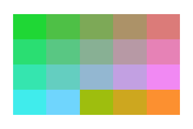
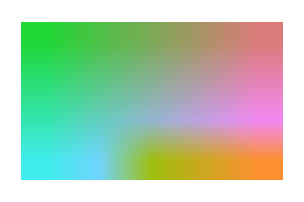

# Add opt-in smooth sampling for magnified images

## Requested capability, not a universal correctness repair

The default renderer preserves sample blocks when an enlarged raster omits `/Interpolate`. A caller wanting a smoother display previously had no rendering-policy switch to override that document choice. `PdfRenderOptions.SmoothMagnifiedImages=true` selects the existing bilinear sampler for eligible magnified, non-stencil images, including decoded alpha. False remains the default. This is the adjacent `08-patterned-stencil-coverage` → `09-image-smoothing` change.

This control is a newly authored 5×4 RGB array, enlarged to 166×100 points, with no `/Interpolate` key. It demonstrates the opt-in appearance and compatibility of the unchanged default. It does NOT demonstrate that smooth output is universally more correct or closer to these reference renderers. All three references choose unsmoothed samples for this input.

## Raw full-page comparison

### Before, default

### After, default false, unchanged pixels

### After, explicitly opted in

### References

## What is verified

Before versus after-default is byte-identical in decoded RGBA and PNG. Opt-in changes 62,821/98,304 pixels with whole-page mean absolute RGB difference 7.7949. The image's geometric placement and background are unchanged. PDFium and PDF.js Node Canvas match the default exactly; MuPDF's default difference is MAE 0.1180, confined to boundary sampling. All three differ materially from the opt-in image (MAE approximately 7.795), so do not describe this picture as cross-engine conformance improvement.

Source review confirms enlargement along either axis can enable the policy. The area-reduction step is unchanged; one-to-one images, images reduced along both axes and stencil masks preserve their prior path. Those scope claims are covered by source tests, not by this one enlarged unmasked RGB picture. It also does not visually test explicit `/Interpolate true`, mixed-axis reduction, rotated placement, image alpha or masks.

Exact review-head full PDF suite: 488 passed, 0 skipped. Input, PNG/raw RGBA and assembly hashes are captured and verified; generator reproduction is byte-identical. No timing was measured here and no speedup is claimed; bilinear sampling can cost more than nearest-sample magnification. This is Node Canvas reference rendering, not native browser/WebView testing. See provenance, reproduction, manifest and hashes alongside this file.
