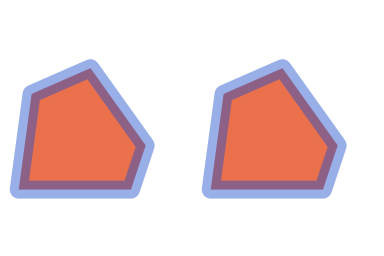
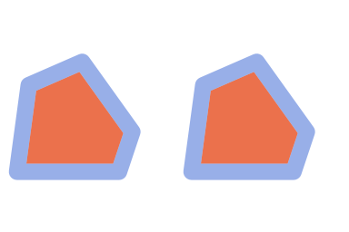
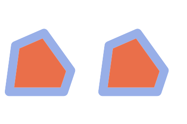
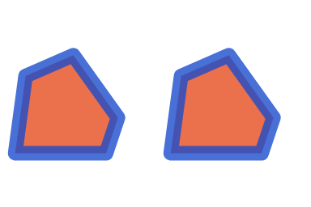

# Stop translucent text outlines from blending over their own fill

**Problem.** Both orange polygon glyphs have a dark inner border before the change. The border is the blue stroke blended over the orange fill, rather than the stroke replacing that fill in the combined painting operation.

**Cause and fix.** The old outline path painted fill then stroke using ordinary compositing. The corrected path subtracts the stroke outline from the painted fill for eligible combined modes 2 and 6, then paints the stroke. It retains the original glyph outline for text clipping. Eligibility is intentionally conservative: one nonempty glyph or proved pixel-disjoint bounds, nonzero translucent stroke, no alpha-as-shape or overprint, with coordinate/complexity guards. Overlapping/uncertain runs and multi-glyph dashed runs retain earlier behavior. This is not a general text-knockout completion.

**Repro and expected control.** `outline-knockout.pdf` uses a newly constructed polygon glyph once in mode 2 and once in mode 6, with fill RGB (0.9,0.3,0.12), fill alpha 0.8, stroke RGB (0.1,0.3,0.8), stroke alpha 0.45, line width 9, font size 92, round joins. In a fully covered stroke band over white, expected normalized RGB is 0.45 × stroke + 0.55 × white = (0.595,0.685,0.91), approximately bytes (152,175,232). That color should be the same on both sides of the original glyph boundary. The fill interior is approximately (235,112,75), allowing intermediate byte rounding. These are analytic checks, not sampled reference expectations.

**Observed.** At original image coordinates (60,184), inside the fill boundary but inside the stroke, before RGB is (141,97,134); after is (152,175,232). At (60,194), outside the fill but in the same lower stroke, both before and after are (152,175,232). The fill at (60,150) remains (235,113,76). This is the exact user-visible repair. Before/after changes 7,728 pixels. The two glyphs remain visually equivalent; their translated modes differ in 2 pixels before and 4 after, so do not claim byte-identical mode outputs. This PDF has no subsequent painting to exercise the mode-6 text clip, and cannot independently prove clip preservation.

**References.** PDFium and MuPDF give (152,175,232) for both selected stroke pixels, consistent with the analytic rule. PDF.js does not: inner (68,83,178), outer (72,112,214). The difference includes an outer-stroke opacity/color difference, not just the knockout boundary. Do not attribute a precise PDF.js cause without inspecting that implementation. Whole-page reference MAE moves 4.460→0.187 (PDFium), 4.812→0.453 (MuPDF), but 7.394→9.766 (PDF.js). Publish the disagreement instead of dropping the inconvenient reference. AA and byte rounding account for some residual disagreement but cannot explain its large flat-region differences.

## Raw full-page images

### Before

### After

### PDFium

### MuPDF

### PDF.js Node Canvas

The images retain native 384×256 dimensions at 144 DPI. Labels are outside the raw files. See `analytic-checks.json`, `PROVENANCE.md`, `REPRODUCTION.md`, `manifest.json`, `metrics.json` and `SHA256SUMS`.

Semantic basis: [ISO 32000-1:2008](https://opensource.adobe.com/dc-acrobat-sdk-docs/standards/pdfstandards/pdf/PDF32000_2008.pdf), 9.3.6 and 11.7.4.4 (combined fill/stroke). Expected pixels and invariants here are derived from the original input, not copied from any specification artwork or reference.
