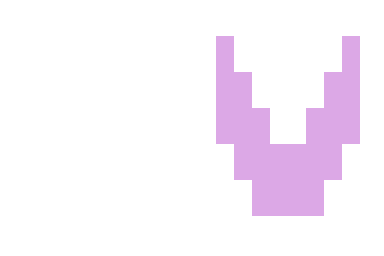
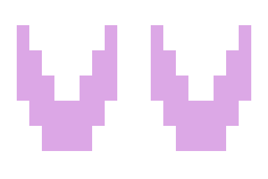
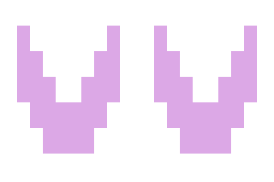
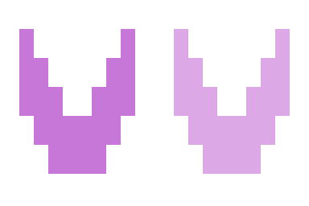
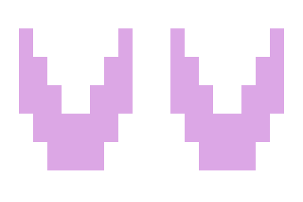

# Count patterned stencil paint in its owning group's alpha

## Problem, cause and fix

The grouped stencil at left disappears, while the equivalent directly painted stencil at right is visible. The unmasked patterned-image path painted into the color target but omitted the owning non-isolated group's coverage canvas. The fix sends the same brush, already carrying pattern alpha, stencil and clip, into that coverage canvas with the object's opacity. Masked images retain the separate compositing path. This is the adjacent `07-passthrough-coverage` → `08-patterned-stencil-coverage` change.

## Read the visual

The original 8×5 one-bit array makes a stepped open shape, painted with a constant purple tiling pattern. Left: object alpha 0.65 inside a group with opacity 0.60. Right: direct object alpha 0.39. They have identical coverage at a translation of 96 points (192 pixels). With no overlap, full pattern opacity and Normal blending, the effective left opacity is 0.65×0.60=0.39, so both should agree up to intermediate byte rounding. The continuous paint-over-white result is RGB (220.1925,167.484,230.1375).

### Before

### After

### References, including the disagreement

## Independent checks and uncertainty

At corresponding painted points (15,100)/(111,100), before left is white and right is (220,168,230). After left is (220,167,230), right remains (220,168,230), both within 1 byte of the numeric expectation. Every corresponding panel pixel differs by at most 1 after, versus 87 before. This is a deliberate opacity-equivalence control, not a reference vote.

PDFium makes the two panels exactly identical. PDF.js Node Canvas differs by at most 1 byte between them. MuPDF instead paints left (199,119,215), right (220,168,230), with panel differences up to 49: a material opacity/color disagreement, not explainable by edge AA. The precise MuPDF implementation cause is unresolved. Publish both its raw output and this limitation; do not silently drop it or call a broadly established MuPDF defect. The expected 0.39 opacity follows the grouped and direct operations' parameters and the group model in [ISO 32000-1:2008, 11.4](https://opensource.adobe.com/dc-acrobat-sdk-docs/standards/pdfstandards/pdf/PDF32000_2008.pdf).

14,256/98,304 pixels change before→after. Whole-page RGB MAE against PDFium: 7.1060→0.0483; MuPDF: 11.2148→4.0605; PDF.js Node Canvas: 7.2510→0.0967. Metrics describe the captured outputs, not conformance scores.

Exact review-head full PDF suite: 454 passed, 0 skipped. In a deliberate production-revert control, both unmasked patterned-stencil cases failed and both masked controls passed. The visible PDF uses full pattern opacity, no soft mask and a rectangular image transform; the source tests, not this picture, cover those additional distinctions. See analytic checks, provenance, reproduction and manifest. No performance/native-browser claim is made.
