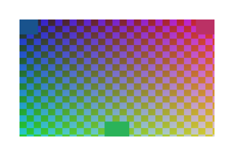
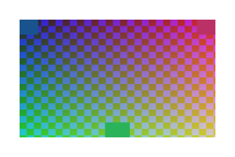
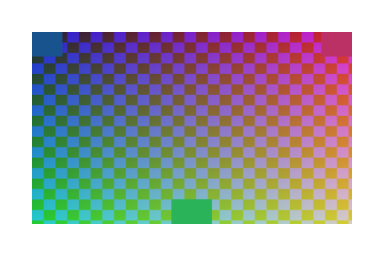
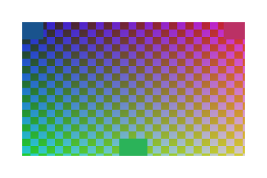

> Lossless transport packaging (2026-11-15): the four raw RGBA buffers are stored as deterministic `.rgba.gz` files. The readable PNGs, PDF, numerical source, timing results, and original `manifest.json` are unchanged. See [PACKAGING.md](PACKAGING.md) to reconstruct and hash-check the complete original package before running its checks. The frozen manifest and original `SHA256SUMS` describe that reconstructed package, not the transport-facing README/reproduction additions.

# Cache horizontal reduction weights without changing pixels

This is a performance-only fix. The before and after images intentionally look identical: zero changed pixels is a required result, not missing evidence. The measured problem is repeated horizontal mapping work when reducing a large PDF image.

## Problem, cause, and fix

`Resize.Area` used to calculate the same horizontal destination positions and overlap weights again for every source row. The fix calculates them once per reduction and reuses them across rows, preserving the existing accumulation order and byte rounding. Scratch storage is pooled and bounded; images wider than 16,384 pixels and single-row images keep the scalar path.

This independently authored MIT control contains one 1009×751 RGB image, reduced to 320×192 device pixels. It combines numerical ramps, alternating tiles, single-pixel variation, and three solid calibration regions. There are no fonts or borrowed pictures. The production PDF path computes a 320×192 image footprint at 144 DPI and calls `Resize.Area` because both source axes exceed 1.25 times that footprint. The cache predicate is true (`751 > 1`, `1009 <= 16384`). From the exact source loops, horizontal mappings are calculated 757,759 times before and 1,009 times after. This is a count of mappings, not a 751× speedup claim or profiler counter.

## Raw full-page evidence

All five PNGs are unedited 384×256 pages. Labels are outside the image. There is no crop, resize, registration, contrast adjustment, or difference-image substitution.

| Before | After | PDFium | MuPDF | PDF.js, Node Canvas |
|---|---|---|---|---|
|  |  |  |  |  |

Both page PNG files have SHA-256 `a989a6fb961fe0c7b64c401ba134f59a4dcb521762f4ead409a66690dd874494`. Both full-page raw RGBA buffers have SHA-256 `10c746d1fc254190a534195cb5c1358e5a9a2166477c168363ee32133d862445`.

## Independent pixel check

The checker derives area averages from integer interval intersections, independently of the renderer and its scalar regression test. Every one of the 61,440 reduced RGB pixels matches the rounded analytical expectation exactly on both sides. Every alpha byte is 255. The entire 320×192 PDF image region equals the directly invoked production `Resize.Area` output. All 98,304 full-page pixels are identical before/after, including the white margin. PNG decode equals the saved raw RGBA buffers.

Three flat-region controls remain exactly RGB (25,83,141), (187,49,101), and (43,179,89). See [analytic checks](analytic-checks.json) and [original checker](tools/check.py).

Reference engines are comparators, not interchangeable oracles. Compared with either OneImage result, PDFium's largest channel difference is 2; MuPDF's is 48; PDF.js Node Canvas's is 50. Their differing edge samples are preserved. This package does not establish the precise resampling causes of those differences or native-browser parity. The analytical check and before/after identity do not depend on selecting the closest reference.

## Controlled timing

Six fresh processes ran in a coordinated quiet window, in order before, after, after, before, before, after. Each boundary had 10 retained warmup operations followed by 25 measured operations, batch size 1. No samples were discarded. All 120 warmup and 300 measured outputs passed their raw-pixel hashes.

| Process | Side | Production Area median, ms | Fresh PDF load/render median, ms |
|---|---|---:|---:|
| 1 | Before | 6.1783 | 20.6525 |
| 2 | After | 4.8312 | 20.1113 |
| 3 | After | 4.8277 | 20.8353 |
| 4 | Before | 6.0550 | 20.8056 |
| 5 | Before | 6.0768 | 20.5282 |
| 6 | After | 5.1059 | 19.3325 |

The median of three process medians for production Area is **6.0768 → 4.8312 ms, 20.50% lower** on this workload. Before process medians range 6.0550–6.1783 ms; after range 4.8277–5.1059 ms. Fresh-PDF medians overlap: before 20.5282–20.8056 ms, after 19.3325–20.8353 ms. **No clear end-to-end speedup is claimed.** The numerical fresh-PDF median-of-medians change is descriptive only.

These are controlled steady-state measurements, not default-runtime, cold-start, native-viewer, or general PDF benchmarks. Runtime was .NET 10.0.15, SDK 10.0.404, Debian 13 x64; `DOTNET_PROCESSOR_COUNT=2`, tiered compilation and tiered PGO both disabled. PDF copy degree is 1. Area-only excludes source decompression and construction. Fresh-PDF includes a new document load, parsing, decode/reduction, rendering and pixel copy every operation; it excludes reading the PDF file from disk. Reusing an already-loaded page would hit its image-resource cache and conceal this work, so it is deliberately not that benchmark. The delegates, input construction, one verification call per boundary, hash checks, and file writes are outside the stopwatch. GC is not forced between samples. Warm pools are intentional.

Area current-thread allocation is 245,824 bytes per measured operation on both sides; that includes the harness's stopwatch allocation. Fresh-PDF current-thread allocation is 8,624,704–8,631,904 bytes on both sides. These are not peak-memory or whole-process-allocation measurements. The new cache has 16,144 logical bytes of weight entries on this input, plus pool bucket capacity/overhead; its initial pool allocation is outside steady-state timing. No memory reduction is claimed.

[All process data](measurements/) · [summary and checks](timing-summary.json) · [reproduction](REPRODUCTION.md) · [MIT provenance](PROVENANCE.md)

## Scope and validation

The exact split head contains the original reduction-cache fix `30b94921b3545c79fbbe52406eb62196223c4cb1`, separated from unrelated changes. Source before tree: `e26ce6d8dd234a608c4bcf2d1a2f6f46d1f16b45`; head: `a3895db911a64996ce997e6274703a4b6a15d737`. Exact source and assembly hashes are recorded in the manifest. No production source was changed for measurement.

The head's existing full PDF suite passed **499 tests, zero failures/skips/not-run**; the saved [test log](validation/source-head-tests.log) is included. This is not an all-solution/core-suite claim. This new appearance control exercises opaque RGB in the normal cache branch; it does not itself prove transparent, stencil, cancellation, concurrent, ultra-wide, or single-row behavior. The existing source tests cover those additional areas separately. The original generator reproduced all fixture bytes, and the final rebuilt harness reproduced all captured render bytes. Neither evidence nor source was merged by this review.
